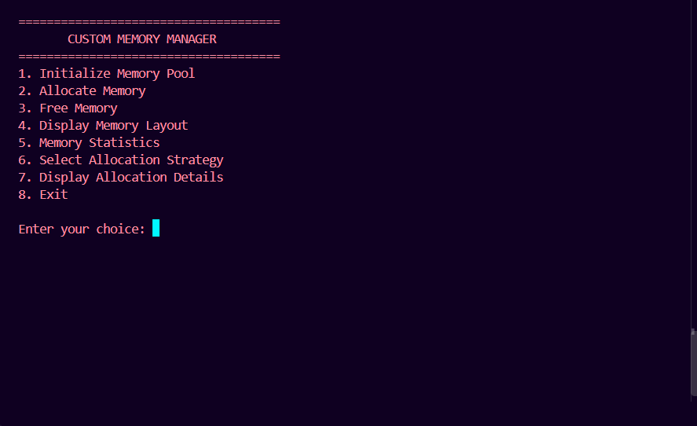
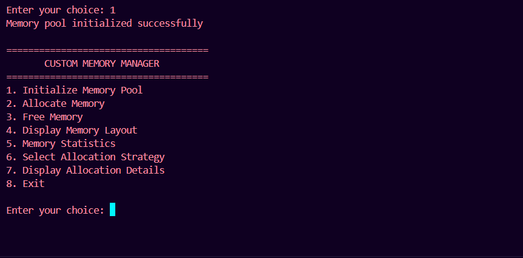
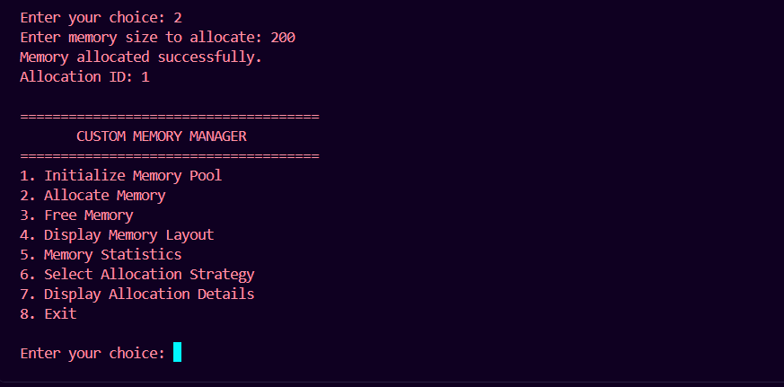
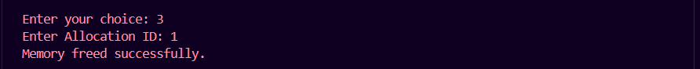
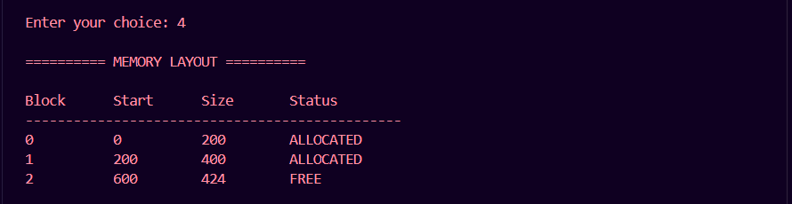
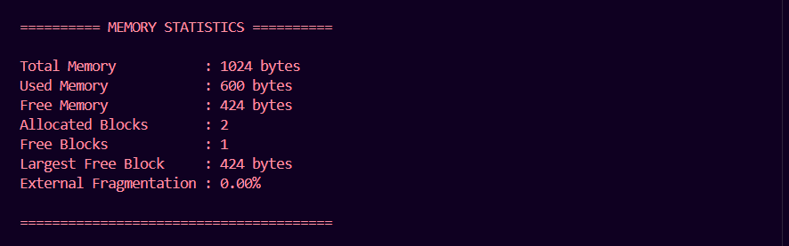

# Custom Memory Manager Simulator

A pure C project that simulates dynamic memory allocation and deallocation using a fixed-size memory pool.

The project demonstrates how memory allocation strategies work internally through **First Fit, Best Fit, and Worst Fit** algorithms.

## Overview

The simulator manages a 1024-byte memory pool created using `malloc()`. It maintains memory block information using an array of structures and handles allocation, deallocation, block splitting, and merging.

This is an educational simulation of memory management. It does not replace or modify the operating system's actual memory allocator.

## Features

- Dynamic initialization of a 1024-byte memory pool
- First Fit allocation strategy
- Best Fit allocation strategy
- Worst Fit allocation strategy
- Memory allocation using requested sizes
- Memory deallocation using unique allocation IDs
- Memory block splitting
- Merging of adjacent free blocks
- Memory layout display
- Memory usage statistics
- Largest free block calculation
- External fragmentation calculation
- Basic input validation and error handling

## Allocation Strategies

| Strategy | Description |
|---|---|
| First Fit | Selects the first free block large enough for the request. |
| Best Fit | Selects the smallest suitable free block. |
| Worst Fit | Selects the largest suitable free block. |

## How It Works

1. Initialize a memory pool of 1024 bytes.
2. Receive a memory allocation request.
3. Search for a suitable free block using the selected strategy.
4. Allocate the requested portion of the block.
5. Split the remaining space into a new free block when necessary.
6. Deallocate memory using its allocation ID.
7. Merge adjacent free blocks after deallocation.
8. Display memory layout and statistics.

## Project Structure

```text
custom-memory-manager/
│
├── main.c
├── memory_manager.c
├── allocation.c
├── deallocation.c
├── display.c
│
├── memory_blocks.h
├── memory_manager.h
├── memory_operations.h
│
├── screenshots/
│   ├── menu.png
│   ├── memory_initialized.png
│   ├── memory_allocation.png
│   ├── memory_deallocation.png
│   ├── memory_layout.png
│   └── memory_statistics.png
│
├── .gitignore
└── README.md
```

## Screenshots

### Main Menu



### Memory Pool Initialization



### Memory Allocation



### Memory Deallocation



### Memory Layout



### Memory Statistics



## Requirements

- GCC compiler
- Git (optional, for cloning the repository)

## Compilation and Execution

### Windows (PowerShell)

```powershell
gcc main.c memory_manager.c allocation.c deallocation.c display.c -o memory_manager.exe
.\memory_manager.exe
```

### Linux

```bash
gcc main.c memory_manager.c allocation.c deallocation.c display.c -o memory_manager
./memory_manager
```

## Concepts Demonstrated

- C structures
- Pointers and pointer arithmetic
- Dynamic memory allocation using `malloc()` and `free()`
- Arrays of structures
- Modular programming using header and source files
- Memory block management
- Searching and allocation algorithms
- Memory fragmentation

## Author

**Prashant Kumar**

